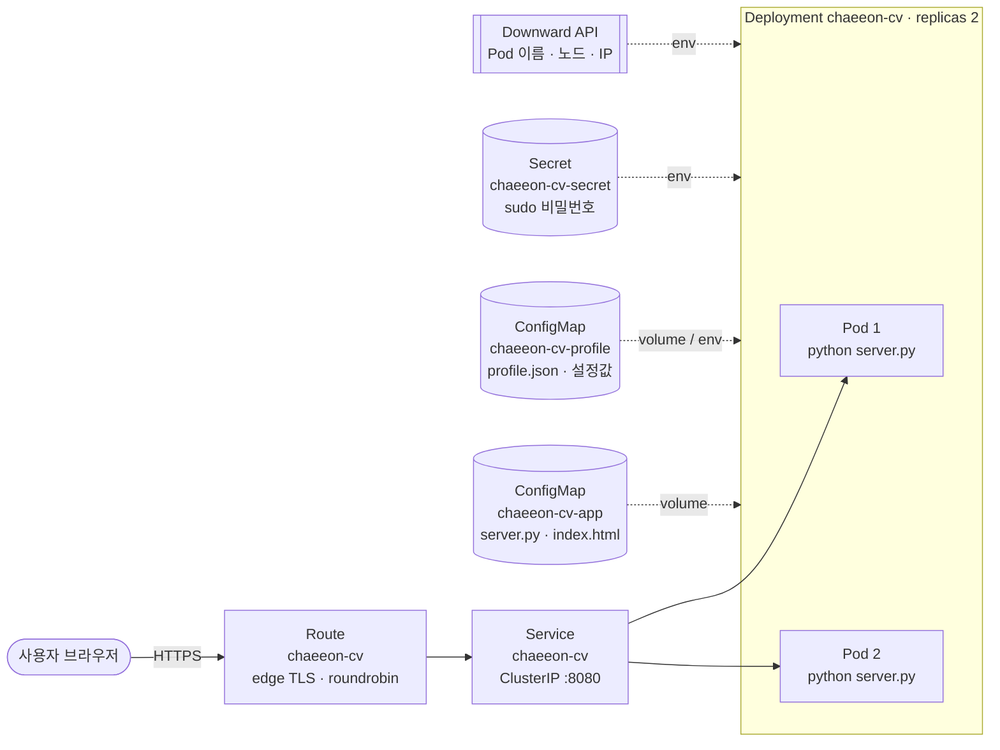

# chaeeon-cv — OpenShift 위에서 돌아가는 터미널 포트폴리오

> 지능형IoT플랫폼 · 나만의 컨테이너 만들기 · 2023XXXXXX 여채언

## 1. 컨테이너 소개

| 항목 | 내용 |
|---|---|
| 서비스 이름 | **chaeeon-cv** |
| 한 줄 설명 | 리눅스 터미널처럼 명령어를 입력해 탐색하는 포트폴리오 웹사이트. 화면에 보이는 Pod 이름·노드·로드밸런싱이 **실제 OpenShift 런타임 정보**입니다. |
| 접속 주소 | `https://<Route 주소>/` (터미널) · `https://<Route 주소>/#portfolio` (일반 포트폴리오 화면) |

**이 주제를 고른 이유**

- 실제로 쓸 수 있는 개인 포트폴리오(연구 경력, 프로젝트, 수상, 연락처)를 만들고 싶었습니다.
- 정적 자기소개 페이지에서 끝내지 않고, 수업에서 배운 Object(ConfigMap, Secret, Probe, Service 로드밸런싱)가 **화면에서 눈으로 확인되도록** 설계했습니다.

**주요 기능**

| 기능 | 설명 | 사용한 OpenShift 기능 |
|---|---|---|
| 터미널 포트폴리오 | `about`, `research`, `experience`, `projects`, `skills`, `awards`, `contact` 명령. Tab 자동완성, ↑↓ 히스토리, 오타 추천(`did you mean`), 클릭 가능한 명령 버튼 | ConfigMap(`profile.json`) |
| 일반 포트폴리오 화면 | 우측 상단 **Portfolio** 버튼 또는 `gui` 명령. 터미널이 익숙하지 않은 사람도 볼 수 있는 일반 이력 페이지. 모바일 대응 | ConfigMap |
| Pod 정보 조회 | `neofetch`, `oc get pod`, `oc describe pod`, `hostname` → 지금 응답한 Pod 이름/namespace/노드/IP/리소스 제한 | Downward API |
| 로드밸런싱 시각화 | `lb 10` → `/api/info`를 10번 호출해 어떤 Pod가 몇 번 응답했는지 막대그래프로 표시 | Deployment replicas 2, Service, Route(라운드로빈) |
| 관리자 숨김 메시지 | `sudo cat .secret` → 비밀번호 입력 → 서버가 Secret 값과 비교 후 숨겨진 메시지 표시. 1분 5회 시도 제한 | Secret |
| 헬스체크 | `/healthz`(Liveness), `/readyz`(Readiness: ConfigMap 파일이 마운트됐는지 확인) | Probe |
| 테마 | `theme sim / paper / phosphor` (기본값은 ConfigMap의 `DEFAULT_THEME`) | ConfigMap → 환경변수 |

## 2. 아키텍처



**요청 흐름**: 사용자 → **Route**(HTTPS 종료, 라운드로빈) → **Service**(`app: chaeeon-cv` label로 Pod 선택) → **Pod**(Python 서버가 ConfigMap의 `index.html` 응답) → 브라우저의 JavaScript가 `/api/profile`, `/api/info`를 호출해 화면을 그림

**사용한 Object와 역할**

| 파일 | Kind / 이름 | 역할 |
|---|---|---|
| `k8s/deployment.yaml` | Deployment `chaeeon-cv` | Pod 2개 실행. 이미지·명령·포트·환경변수·볼륨·리소스·Probe·보안 설정 정의. RollingUpdate(`maxUnavailable: 0`)로 업데이트 중에도 무중단 |
| `k8s/service.yaml` | Service `chaeeon-cv` | `app: chaeeon-cv` label을 가진 Pod들에 8080 포트로 트래픽 분산 |
| `k8s/route.yaml` | Route `chaeeon-cv` | 외부 HTTPS 주소 제공(host 자동 생성). sticky 쿠키를 끄고 roundrobin으로 설정해 요청마다 다른 Pod가 응답하도록 함 |
| `k8s/configmap-app.yaml` | ConfigMap `chaeeon-cv-app` | 애플리케이션 코드(`server.py`, `index.html`)를 `/opt/app-root/app`에 마운트 → **이미지 빌드 없이** 공개 이미지에 코드 주입 |
| `k8s/configmap-profile.yaml` | ConfigMap `chaeeon-cv-profile` | 포트폴리오 내용(`profile.json`)을 파일로, 화면 설정(`WELCOME_MESSAGE`, `DEFAULT_THEME`)을 환경변수로 주입. 내용과 코드를 분리 |
| `k8s/secret.yaml` | Secret `chaeeon-cv-secret` | `sudo` 비밀번호와 숨김 메시지를 환경변수로 주입 |
| (deployment 내부) | Downward API | `POD_NAME`, `POD_NAMESPACE`, `NODE_NAME`, `POD_IP`, CPU/메모리 limit을 환경변수로 주입 |
| (deployment 내부) | Readiness / Liveness Probe | `/readyz`가 실패하면 Service에서 제외, `/healthz`가 3번 연속 실패하면 컨테이너 재시작 |

**설계 포인트**

- **비루트·고포트**: OpenShift는 임의 UID로 실행하므로 UBI 이미지 + 8080 포트를 사용하고, `allowPrivilegeEscalation: false`, `capabilities.drop: [ALL]`, `seccompProfile: RuntimeDefault`로 restricted-v2 SCC에 맞췄습니다.
- **재현성**: YAML에 `namespace`, Route `host`, `uid`, `status` 등 자동 생성 필드가 없어 어느 프로젝트에서든 `oc apply -f k8s/` 한 번으로 배포됩니다.
- **ConfigMap 자동 반영**: `profile.json` 볼륨에 `subPath`를 쓰지 않아, ConfigMap을 수정하면 재배포 없이 약 1분 안에 화면에 반영됩니다. 서버가 요청마다 파일을 다시 읽기 때문입니다.
- **보안**: 화면에 넣는 데이터는 모두 `textContent`로 렌더링(XSS 방지), 비밀번호는 `hmac.compare_digest`로 상수 시간 비교, `sudo`는 IP당 1분 5회로 제한합니다.

## 3. 사용 이미지

| 항목 | 내용 |
|---|---|
| 이미지 | `registry.access.redhat.com/ubi9/python-311:latest` |
| 노출 포트 | `8080/TCP` (이름 `http`) |
| 실행 명령 | `python3 -u /opt/app-root/app/server.py` (ConfigMap으로 주입된 코드) |

**선택 이유**

- Red Hat UBI 이미지라 OpenShift의 **임의 UID 비루트 실행**을 기본 지원합니다.
- `registry.access.redhat.com`에서 받기 때문에 Docker Hub 다운로드 횟수 제한이 없습니다.
- 서버를 **Python 표준 라이브러리만으로** 작성해 `pip install`이나 이미지 빌드가 필요 없습니다. 공개 이미지 + ConfigMap만으로 서비스가 완성됩니다.
- 메모리 사용량이 작아(limit 128Mi) Sandbox 할당량 안에서 Pod 2개를 여유 있게 띄울 수 있습니다.

## 4. 배포 방법

```bash
# 1) 로그인 (웹 콘솔 우측 상단 → Copy login command)
oc login --token=<토큰> --server=<서버 주소>

# 2) 이 폴더에서 배포
cd students/2023XXXXXX
oc apply -f k8s/

# 3) 확인
oc get pods -l app=chaeeon-cv        # 2개 모두 1/1 Running
oc get endpoints chaeeon-cv          # Pod IP 2개가 연결돼 있어야 함
oc get route chaeeon-cv -o jsonpath='https://{.spec.host}{"\n"}'
```

**접속 후 확인할 것**

| 경로 / 명령 | 예상 결과 |
|---|---|
| `https://<host>/` | 부팅 메시지, `serving from chaeeon-cv-xxxx` 와 함께 터미널 화면 |
| `https://<host>/#portfolio` | 일반 포트폴리오 페이지 |
| 터미널에서 `lb 10` | 서로 다른 Pod 이름 2개가 나뉘어 응답 |
| 터미널에서 `sudo cat .secret` → 비밀번호 `sim2real-2026` | 숨겨진 메시지 출력 (Secret 값) |
| `curl https://<host>/healthz` | `{"status": "ok"}` |
| `curl https://<host>/api/info` | 응답한 Pod의 이름·namespace·노드 JSON |

**재현성 검증**

```bash
oc delete -f k8s/
oc apply -f k8s/
```

**내용 수정하기**: `src/`의 파일을 고친 뒤 `python3 tools/gen_configmaps.py`로 ConfigMap YAML을 다시 만들고 `oc apply -f k8s/` 합니다.

- `profile.json`만 바꾼 경우 자동으로 반영됩니다.
- 코드나 환경변수를 바꾼 경우 `oc rollout restart deployment/chaeeon-cv`가 필요합니다.

## 5. 배포 결과

<!-- TODO: 본인 Sandbox에서 캡처 후 아래 파일명으로 images/ 에 저장하세요 -->

**`oc get all -l app=chaeeon-cv`**

```text
(여기에 실제 출력 붙여넣기)
```

**Topology 화면**


**브라우저 접속 화면 — 터미널 (`neofetch`, `lb 10` 실행 후)**


**브라우저 접속 화면 — 포트폴리오**


## 6. 어려웠던 점

<!-- TODO: 실제로 겪은 오류가 있다면 아래 형식으로 추가하세요 -->

| 문제 | 원인 | 해결 |
|---|---|---|
| `lb` 명령을 실행해도 항상 같은 Pod만 응답 | OpenShift Route는 기본적으로 쿠키 기반 sticky session을 사용 | Route에 `haproxy.router.openshift.io/disable_cookies: "true"`, `balance: roundrobin` 어노테이션 추가 |
| ConfigMap을 수정해도 화면이 바뀌지 않을 수 있음 | `subPath`로 마운트하면 ConfigMap 변경이 Pod에 전파되지 않음 | 디렉터리 전체를 마운트하고, 서버가 요청마다 파일을 다시 읽도록 구현 |
| 공개 이미지에 코드를 넣는 방법 | 과제 조건상 이미지를 직접 빌드하지 않음 | 표준 라이브러리만 쓰는 서버를 ConfigMap으로 마운트하고 `command`로 실행 |
| `sudo` 시도 제한이 우회될 수 있음 | `X-Forwarded-For` 첫 값은 클라이언트가 위조 가능 | 라우터가 덧붙이는 마지막 값을 클라이언트 IP로 사용 |

## 7. AI·참고자료 활용 내역

| 도구 / 자료 | 용도 |
|---|---|
| Claude (Anthropic) | 주제 아이디어 정리, 터미널 웹 UI·Python 서버 코드 초안, Deployment/Service/Route/ConfigMap/Secret YAML 초안, README 초안 작성. 생성된 YAML은 본인 Developer Sandbox에 직접 배포해 동작을 확인함 |
| [OpenShift Docs — Route configuration](https://docs.openshift.com/container-platform/latest/networking/routes/route-configuration.html) | Route 어노테이션(`disable_cookies`, `balance`), edge TLS 설정 |
| [Kubernetes Docs — Downward API](https://kubernetes.io/docs/concepts/workloads/pods/downward-api/) | Pod 이름·노드·리소스 제한을 환경변수로 주입 |
| [Kubernetes Docs — ConfigMaps](https://kubernetes.io/docs/concepts/configuration/configmap/) | 볼륨 마운트 시 자동 업데이트(`subPath` 예외) |
| [Kubernetes Docs — Liveness, Readiness Probes](https://kubernetes.io/docs/tasks/configure-pod-container/configure-liveness-readiness-startup-probes/) | Probe 설정 |
| [Red Hat Ecosystem Catalog — UBI Python](https://catalog.redhat.com/en/software/containers/search?q=ubi9%20python) | 비루트 실행 이미지 선택 |

---

### 폴더 구조

```text
students/2023XXXXXX/
├── README.md
├── k8s/                       ← 채점 대상 (oc apply -f k8s/)
│   ├── configmap-app.yaml       코드 (server.py, index.html)
│   ├── configmap-profile.yaml   포트폴리오 내용 + 화면 설정
│   ├── secret.yaml              sudo 비밀번호
│   ├── deployment.yaml
│   ├── service.yaml
│   └── route.yaml
├── src/                       ← ConfigMap 원본 소스 (편집용)
│   ├── server.py
│   ├── index.html
│   └── profile.json
├── tools/gen_configmaps.py    ← src/ → k8s/configmap-*.yaml 생성
└── images/                    ← 배포 결과 캡처
```

> `secret.yaml`의 비밀번호는 채점 재현을 위한 **데모 값**입니다. 실제 서비스라면 Secret을 Git에 올리지 않고 Sealed Secrets 등을 사용합니다.
