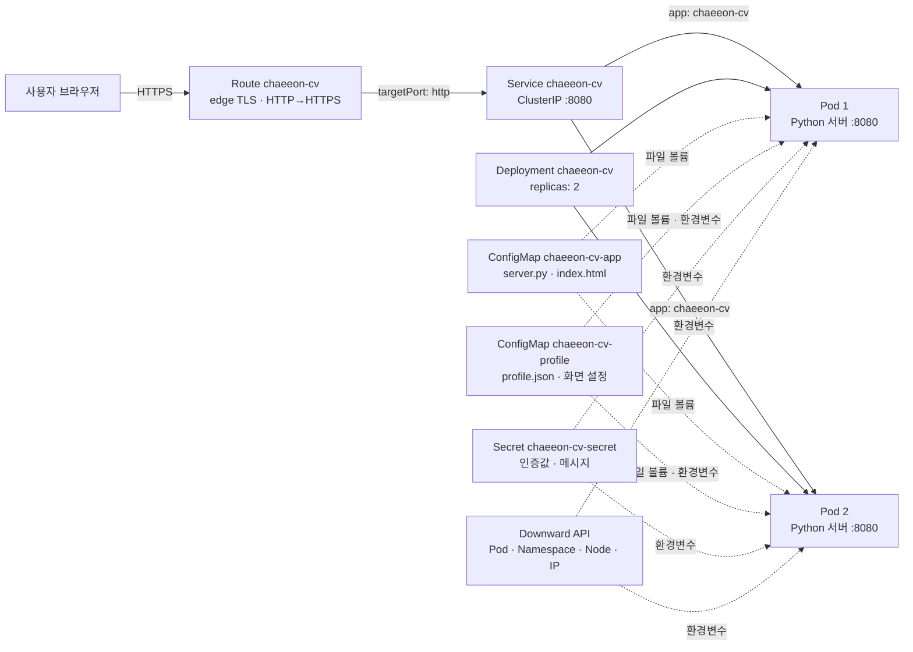
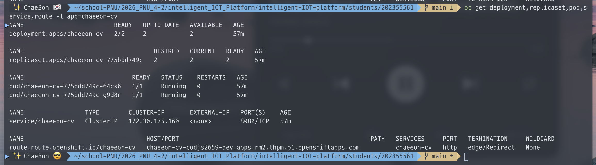
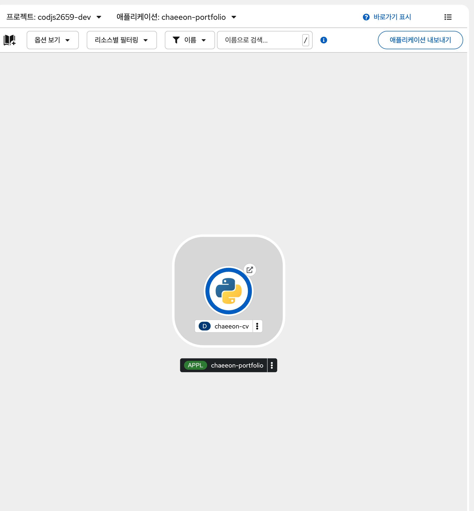
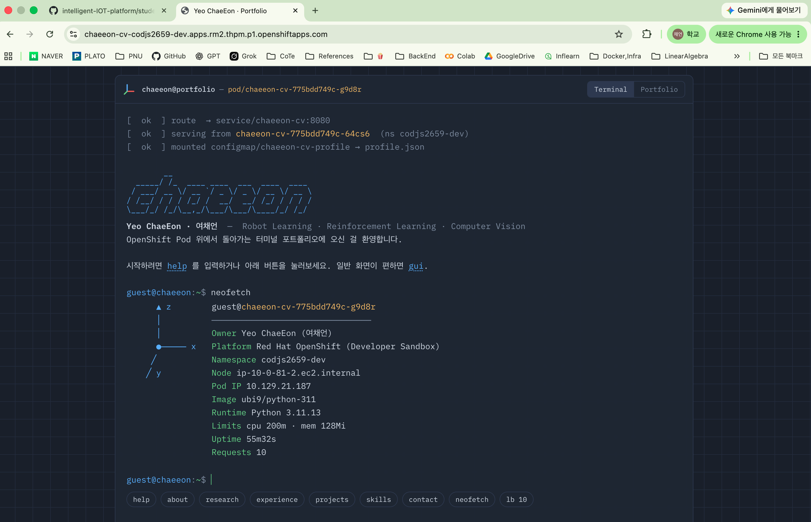

# chaeeon-cv — OpenShift 터미널 포트폴리오

> 지능형IoT플랫폼 · 나만의 컨테이너 만들기 · `students/202355561`

## 1. 컨테이너 소개

**chaeeon-cv**는 명령어를 입력해 이력과 프로젝트를 탐색하는 포트폴리오 웹 서비스입니다. `gui` 명령이나 Portfolio 버튼으로 일반 포트폴리오 화면도 볼 수 있습니다. 자기소개 페이지를 수업의 OpenShift Object와 연결해, 현재 요청을 처리한 Pod 정보와 복제본 사이의 요청 분산을 화면에서 확인할 수 있도록 만들었습니다.

| 기능 | 사용 방법 | 구성 요소 |
|---|---|---|
| 터미널 포트폴리오 | `about`, `research`, `experience`, `projects`, `skills`, `awards`, `contact` | `profile.json` ConfigMap |
| 일반 포트폴리오 | `gui` 또는 `/#portfolio` | 브라우저 UI |
| 실행 Pod 정보 | `neofetch`, `oc get pod`, `hostname` | Downward API, `/api/info` |
| 요청 분산 시각화 | `lb 10` | Pod 2개, Service, Route |
| 숨김 메시지 | `sudo cat .secret` | Secret, `/api/sudo` |
| 상태 확인 | `/healthz`, `/readyz` | Liveness / Readiness Probe |

## 2. 아키텍처



브라우저 요청은 Route에서 HTTPS를 종료한 뒤 Service를 거쳐 Ready 상태의 Pod로 전달됩니다. Python 서버는 ConfigMap으로 마운트한 `index.html`을 반환하고, 브라우저는 `/api/profile`과 `/api/info`를 호출합니다. Route에는 쿠키 비활성화와 `roundrobin` 어노테이션이 설정되어 있습니다. **실제 `lb 10` 실행에서 두 Pod가 모두 관찰됐는지는 캡처 전까지 미확인**입니다.

### Object와 역할

| 파일 | Object | 역할 |
|---|---|---|
| `k8s/deployment.yaml` | Deployment `chaeeon-cv` | UBI Python 컨테이너 2개, 리소스, 볼륨, 환경변수, Probe를 정의합니다. RollingUpdate는 `maxUnavailable: 0`, `maxSurge: 1`입니다. |
| `k8s/service.yaml` | Service `chaeeon-cv` | `app: chaeeon-cv` Pod를 선택하고 8080/TCP를 컨테이너의 `http` 포트에 연결합니다. |
| `k8s/route.yaml` | Route `chaeeon-cv` | 자동 생성된 호스트로 외부 접속을 제공하며 edge TLS와 HTTP→HTTPS 리다이렉트를 설정합니다. |
| `k8s/configmap-app.yaml` | ConfigMap `chaeeon-cv-app` | `server.py`, `index.html`을 `/opt/app-root/app`에 읽기 전용 마운트합니다. |
| `k8s/configmap-profile.yaml` | ConfigMap `chaeeon-cv-profile` | `profile.json`을 `/opt/app-root/profile`에 마운트하고 환영 문구와 테마를 환경변수로 제공합니다. |
| `k8s/secret.yaml` | Secret `chaeeon-cv-secret` | 데모용 `sudo` 인증값과 메시지를 환경변수로 제공합니다. 실제 비밀값은 README와 캡처에 표시하지 않습니다. |
| `k8s/deployment.yaml` 내부 | Downward API | Pod 이름·namespace·노드·IP와 리소스 제한을 서버에 전달합니다. |
| `k8s/deployment.yaml` 내부 | Readiness / Liveness Probe | `/readyz`로 마운트 파일 준비 여부를 확인하고 `/healthz`로 서버 생존 여부를 확인합니다. |

## 3. 이미지와 실행 설정

| 항목 | 설정 |
|---|---|
| 이미지 | `registry.access.redhat.com/ubi9/python-311:latest` |
| 별도 이미지 빌드 | 없음. 과제 PDF는 공개 이미지 선택과 Object 구성을 ‘나만의 컨테이너’로 인정합니다. |
| 실행 명령 | `python3 -u /opt/app-root/app/server.py` |
| 컨테이너 / Service 포트 | `8080/TCP` / `8080/TCP` |
| 리소스 | 요청: CPU 20m·메모리 48Mi, 제한: CPU 200m·메모리 128Mi |
| 보안 | 비루트 실행, 권한 상승 금지, Linux capability 제거, `RuntimeDefault` seccomp |

Python 표준 라이브러리로 서버를 구현해 별도 패키지 설치 없이 공개 UBI Python 이미지에서 실행합니다. `latest` 태그는 시간이 지나면 다른 이미지가 될 수 있으므로 **완전한 이미지 버전 고정은 현재 미구현**입니다.

## 4. 배포 방법

사전 준비: OpenShift Developer Sandbox 계정, `oc` CLI 로그인, 이 저장소의 `students/202355561` 폴더. 웹 콘솔 우측 상단 계정 메뉴의 **Copy login command**에서 본인 로그인 명령을 복사합니다. 토큰은 README나 캡처에 기록하지 않습니다.

```sh
cd students/202355561
oc project
oc apply -f k8s/
oc rollout status deployment/chaeeon-cv
oc get pods -l app=chaeeon-cv
oc get endpoints chaeeon-cv
oc get route chaeeon-cv -o jsonpath='https://{.spec.host}{"\n"}'
```

`oc project`가 본인 Sandbox 프로젝트를 가리키는지 먼저 확인합니다. 매니페스트에는 고정 `namespace`와 Route `host`, 서버 자동 생성 필드가 없어 현재 프로젝트에 적용됩니다. Pod가 2개 모두 `1/1 Running`이고 Endpoints에 주소 2개가 표시되어야 합니다. `oc get all`은 Secret·ConfigMap을 포함하지 않으므로 추가 Object는 별도로 확인합니다.

```sh
oc get all -l app=chaeeon-cv
oc get configmap,secret -l app=chaeeon-cv
HOST=$(oc get route chaeeon-cv -o jsonpath='{.spec.host}')
for endpoint in / /healthz /readyz; do
  echo "Testing $endpoint"
  curl -sS -o /dev/null -w 'HTTP %{http_code}\n' "https://$HOST$endpoint"
done
```

`/`는 터미널 포트폴리오, `/#portfolio`는 일반 포트폴리오 화면입니다. `/healthz`는 서버가 응답하면 HTTP 200을, `/readyz`는 `index.html`과 `profile.json`이 마운트됐을 때 HTTP 200을 반환합니다.

소스 수정 시 `src/` 원본을 편집하고 `python3 tools/gen_configmaps.py`로 `k8s/configmap-*.yaml`을 재생성한 다음 다시 적용합니다. `profile.json` 볼륨은 `subPath` 없이 마운트되며 서버가 요청마다 읽습니다. 화면 설정 환경변수나 앱 코드 변경은 Pod 재시작 후 반영하는 것이 확실합니다.

### 재현성 검증

과제는 채점자가 `k8s/`만으로 재배포합니다. 기존 리소스가 있는 **본인 Sandbox 프로젝트에서만** 아래 절차를 실행하고 결과를 확인합니다. 이 삭제·재배포 절차를 실제 수행했는지는 현재 **미확인**입니다.

```sh
oc delete -f k8s/
oc apply -f k8s/
oc rollout status deployment/chaeeon-cv
oc get pods -l app=chaeeon-cv
oc get route chaeeon-cv
```

## 5. 배포 결과와 증빙

이전 대화에서 사용자가 Route의 `/`, `/healthz`, `/readyz` 경로가 각각 **HTTP 200**을 반환한다고 확인했습니다. 아래 캡처에는 과제 리소스만 조회한 명령의 정상 출력이 보입니다. Deployment와 ReplicaSet은 **2/2**, Pod 2개는 각각 **1/1 Running**, Service는 **8080/TCP**, Route는 `chaeeon-cv` Service를 대상으로 **edge/Redirect**로 설정되어 있습니다.



OpenShift Developer 콘솔의 Topology에는 `chaeeon-portfolio` 애플리케이션과 Python 런타임의 `chaeeon-cv` Deployment가 표시됩니다. Pod 수와 Service·Route 연결은 위 명령 결과와 2장의 Mermaid 구성도를 참고합니다.



아래 브라우저 캡처에는 Route 호스트와 터미널 포트폴리오의 `neofetch` 실행 결과가 보입니다. 화면에는 Pod 이름, namespace, 노드, Pod IP, 이미지와 리소스 제한이 표시됩니다. 주소창은 호스트를 보여 주지만 프로토콜 문자열은 생략되어 있으므로, **HTTPS 응답 확인은 위의 경로 검사 결과와 Route의 edge TLS 설정을 근거로 합니다.** 웹페이지 디자인은 추후 수정할 예정이며, 이 이미지는 현재 배포 화면의 증빙입니다.



일반 포트폴리오 화면(`/#portfolio`)의 최종 캡처와 삭제 후 재배포 검증 결과는 아직 제공되지 않았습니다. 화면 수정 후 최종 캡처로 교체할 예정입니다.

## 6. 문제 해결 기록

| 실제 확인된 현상 | 확인·해결 과정 |
|---|---|
| 검증 중 `curl`, `ls`, `wc`가 `command not found`로 표시됨 | 이전 대화에 셸 `PATH` 관련 오류가 기록되어 있습니다. 이후 사용자가 다시 실행한 Route 검사에서는 세 경로 모두 HTTP 200이었습니다. `PATH`를 어떻게 수정했는지는 기록이 없어 미확인입니다. |
| `oc get all` 끝에 `applications.app.k8s.io is forbidden` 표시 | `oc get all`이 과제와 무관한 API 리소스도 나열하려 했으나 현재 계정에는 그 목록 조회 권한이 없습니다. 출력된 과제 리소스는 확인했고, 이후에는 `oc get deployment,replicaset,pod,service,route -l app=chaeeon-cv`처럼 필요한 종류만 지정해 확인합니다. |

Route 쿠키 설정, ConfigMap 마운트 방식, 비루트 포트 선택은 매니페스트에 반영된 설계입니다. 해당 문제가 실제 배포에서 발생했다는 실행 기록은 확인되지 않아 문제 해결 사례로 주장하지 않습니다.

## 7. AI·참고자료 활용

기존 README에는 **Claude (Anthropic)**를 주제 정리, UI·서버·YAML·README 초안 작성에 사용했다고 기록되어 있습니다. 이번 README 정리에는 **Codex**를 사용해 과제 PDF의 기준과 프로젝트 파일을 대조하고 검증 상태를 구분했습니다. AI가 작성한 내용의 실제 배포 여부는 사용자 제공 실행 결과를 기준으로 표시했습니다.

- [Kubernetes: ConfigMap](https://kubernetes.io/docs/concepts/configuration/configmap/)
- [Kubernetes: Downward API](https://kubernetes.io/docs/concepts/workloads/pods/downward-api/)
- [Kubernetes: Liveness, Readiness, and Startup Probes](https://kubernetes.io/docs/concepts/configuration/liveness-readiness-startup-probes/)
- [OpenShift: Route configuration](https://docs.openshift.com/container-platform/latest/networking/routes/route-configuration.html)

## 폴더 구조

```text
students/202355561/
├── README.md
├── k8s/
│   ├── configmap-app.yaml
│   ├── configmap-profile.yaml
│   ├── deployment.yaml
│   ├── route.yaml
│   ├── secret.yaml
│   └── service.yaml
├── src/
│   ├── index.html
│   ├── profile.json
│   └── server.py
├── tools/gen_configmaps.py
└── images/                 # 배포 상태·Topology·브라우저 캡처
```

> 과제 제출 전: 웹페이지 수정 후 최종 브라우저 캡처 교체, 본인 Sandbox에서 삭제 후 재배포 검증, 저장소 Push와 URL 제출이 남아 있습니다.
