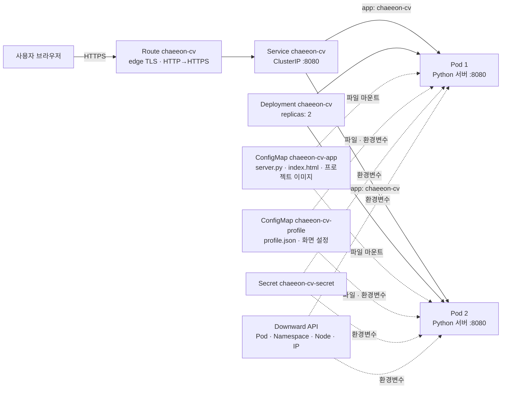

# chaeeon-cv: OpenShift 터미널 포트폴리오

지능형IoT플랫폼 · 나만의 컨테이너 만들기 · `students/202355561`

## 1. 컨테이너 소개

**chaeeon-cv**는 명령어로 이력과 프로젝트를 탐색하는 포트폴리오 웹 서비스입니다. 일반 포트폴리오 화면은 KOR/ENG 언어 전환과 프로젝트별 이미지 또는 기본 카드 화면도 제공합니다. 자기소개 페이지에 OpenShift의 Pod 정보, ConfigMap, Secret, 상태 검사, 복제본 구성을 연결해 수업에서 배운 Object의 역할을 직접 확인할 수 있도록 구성했습니다.

| 기능 | 사용 방법 | 구현 요소 |
|---|---|---|
| 터미널 포트폴리오 | `about`, `research`, `experience`, `projects`, `skills`, `awards`, `contact` | `profile.json` ConfigMap |
| 일반 포트폴리오 | `gui` 또는 `/#portfolio`, 상단 KOR/ENG 버튼 | 브라우저 UI, 프로젝트별 이미지 |
| 실행 Pod 정보 | `neofetch`, `oc get pod`, `hostname` | Downward API, `/api/info` |
| 요청 분산 확인 | `lb 10` | Deployment 복제본 2개, Service, Route |
| 숨김 메시지 | `sudo cat .secret` | Secret, `/api/sudo` |
| 상태 검사 | `/healthz`, `/readyz` | Liveness / Readiness Probe |

## 2. 아키텍처



### 서비스에서 요청이 처리되는 순서

1. 사용자가 Route의 HTTPS 주소에 접속합니다. Route `chaeeon-cv`는 TLS를 종료하고 요청을 같은 이름의 Service로 보냅니다. HTTP 접속은 HTTPS로 리다이렉트합니다.
2. Service `chaeeon-cv`는 `app: chaeeon-cv` 레이블이 붙은 **Ready Pod**를 찾습니다. Service의 8080/TCP는 Pod 안 Python 서버의 이름 붙은 포트 `http`(8080)로 연결됩니다. Service는 클러스터 내부 주소이므로 외부 접속은 Route를 사용합니다.
3. Deployment가 관리하는 Pod 2개는 같은 서버를 실행합니다. 서버는 `/`에서 터미널 화면, `/api/profile`에서 포트폴리오 데이터, `/assets/`에서 카드 이미지를 반환합니다. 브라우저의 GUI 버튼은 같은 페이지에서 화면 모드를 바꾸며, `lb 10`은 `/api/info`를 반복 호출해 응답한 Pod 이름을 보여줍니다.

### 사용한 Object 목록과 각 역할

- **Deployment `chaeeon-cv`** (`k8s/deployment.yaml`): UBI Python 3.11 이미지에서 서버를 실행하고 Pod 2개를 유지합니다. 서버 코드와 포트폴리오 데이터를 각각 ConfigMap에서 읽기 전용으로 마운트합니다. 업데이트 시 `maxUnavailable: 0`, `maxSurge: 1`을 적용하고 CPU·메모리 요청량과 제한량을 지정했습니다. ReplicaSet과 Pod는 Deployment가 자동으로 생성합니다.

- **Service `chaeeon-cv`** (`k8s/service.yaml`): `app: chaeeon-cv` 레이블로 준비된 Pod를 찾아 하나의 내부 접속점으로 묶습니다. Service의 `targetPort: http`는 컨테이너의 8080 포트를 가리킵니다. `/readyz`에 실패한 Pod는 요청 대상에서 빠집니다. 연결된 Pod IP는 `oc get endpoints chaeeon-cv`로 확인할 수 있습니다.

- **Route `chaeeon-cv`** (`k8s/route.yaml`): 브라우저의 HTTPS 요청을 Service의 `http` 포트로 전달합니다. `edge` TLS를 사용하고 HTTP 요청은 HTTPS로 돌립니다. 고정 세션을 끄고 `roundrobin`을 지정해 `lb 10` 명령으로 여러 Pod의 응답을 볼 수 있게 했습니다. Route 주소는 OpenShift가 생성합니다.

- **ConfigMap `chaeeon-cv-app`** (`k8s/configmap-app.yaml`): `server.py`, `index.html`, 프로젝트 카드 이미지 데이터 3개를 `/opt/app-root/app`에 제공합니다. 서버는 여기서 `/` 화면과 `/assets/` 이미지를 반환합니다. 별도 이미지 빌드 없이 공개 Python 이미지를 사용할 수 있습니다.

- **ConfigMap `chaeeon-cv-profile`** (`k8s/configmap-profile.yaml`): `profile.json`을 `/opt/app-root/profile/profile.json`에 제공하고, `/api/profile`을 통해 터미널 명령과 GUI 화면의 이력 데이터를 공급합니다. `WELCOME_MESSAGE`와 `DEFAULT_THEME`도 환경변수로 전달합니다. 파일 내용은 볼륨 갱신 후 새 요청에서 읽지만, 환경변수 변경은 Pod 재시작이 필요합니다.

- **Secret `chaeeon-cv-secret`** (`k8s/secret.yaml`): `SUDO_PASSWORD`와 `SUDO_MESSAGE`를 환경변수로 전달합니다. 웹 터미널의 `sudo cat .secret`에서 입력한 값을 `/api/sudo`가 확인하고, 맞으면 메시지를 반환합니다. 실제 Linux 권한 상승은 아닙니다. 재현용 데모 값이 YAML에 포함되어 있어 실제 비밀정보 저장 용도로 사용하지 않습니다.

### Deployment 안에서 사용하는 기능

- **Downward API:** `fieldRef`로 Pod 이름·namespace·노드·Pod IP를, `resourceFieldRef`로 CPU·메모리 제한을 컨테이너 환경변수에 전달합니다. 서버의 `/api/info`가 이 값을 반환하므로 터미널의 `neofetch`와 `lb 10`에서 실제 실행 Pod 정보를 확인할 수 있습니다.
- **Readiness Probe:** OpenShift가 `/readyz`를 주기적으로 호출합니다. 서버는 `index.html`과 `profile.json` 파일이 있으면 HTTP 200, 없으면 HTTP 503을 반환합니다. 아직 준비되지 않은 Pod로 Service 트래픽이 가지 않도록 합니다.
- **Liveness Probe:** OpenShift가 `/healthz`를 주기적으로 호출합니다. 서버가 응답하지 못하면 컨테이너를 재시작합니다. `/healthz`의 HTTP 200은 서버 응답을 뜻하며 포트폴리오 데이터까지 검증하지는 않습니다.
- **보안 설정:** 비루트 실행, 권한 상승 금지, Linux capability 제거와 `RuntimeDefault` seccomp를 지정했습니다.

Downward API와 Probe는 별도 Object가 아니라 Deployment의 Pod 템플릿에 포함된 설정입니다. 이 서비스는 정적 포트폴리오 데이터를 ConfigMap에서 읽으므로 PVC나 데이터베이스는 사용하지 않습니다.

## 3. 사용 이미지

| 항목 | 설정 |
|---|---|
| 이미지 주소·태그 | `registry.access.redhat.com/ubi9/python-311:latest` |
| 실행 명령 | `python3 -u /opt/app-root/app/server.py` |
| 컨테이너 포트 | `8080/TCP` |
| Service 포트 | `8080/TCP` |
| 리소스 | 요청: CPU 20m·메모리 48Mi / 제한: CPU 200m·메모리 128Mi |

Red Hat UBI Python 이미지는 OpenShift의 비루트 실행 환경에 적합합니다. 서버를 Python 표준 라이브러리로 작성하고 코드를 ConfigMap으로 주입했으므로 별도 이미지 빌드나 패키지 설치 없이 배포할 수 있습니다. 컨테이너는 비루트로 실행하며 권한 상승을 금지하고 Linux capability를 제거합니다.

## 4. 배포 방법

### 4.1 배포

OpenShift Developer Sandbox에 `oc` CLI로 로그인한 다음 저장소 루트에서 학번 폴더로 이동합니다. `oc project`로 적용 대상 프로젝트를 확인하고 배포합니다. 서버 코드와 화면 파일은 ConfigMap YAML에 포함되어 있어 별도의 이미지 빌드나 패키지 설치는 필요하지 않습니다.

```sh
cd students/202355561
oc project
oc apply -f k8s/
```

`oc apply -f k8s/`는 Deployment, Service, Route, ConfigMap 2개와 Secret을 생성하거나 갱신합니다. 명령이 끝나도 Pod가 준비되기까지 시간이 걸릴 수 있습니다.

### 4.2 배포 상태 확인

아래 명령은 추가 배포 명령이 아니라 배포 결과를 확인하는 명령입니다.

```sh
oc rollout status deployment/chaeeon-cv
```

새 Pod가 준비될 때까지 기다립니다. 완료되면 `successfully rolled out`이 표시됩니다.

```sh
oc get deployment,replicaset,pod,service,route -l app=chaeeon-cv
```

Deployment가 `2/2`, Pod 2개가 각각 `1/1 Running`인지 확인합니다. Service 포트와 Route 주소도 여기서 볼 수 있습니다.

```sh
oc get configmap,secret -l app=chaeeon-cv
```

서버 코드용·프로필용 ConfigMap 2개와 Secret 1개가 생성됐는지 확인합니다. Secret 값은 출력하지 않습니다.

```sh
oc get endpoints chaeeon-cv
```

Service가 요청을 보낼 Pod 주소를 찾았는지 확인합니다. 주소가 없다면 Pod의 Ready 상태와 Service selector를 확인해야 합니다.

### 4.3 접속 및 응답 확인

```sh
oc get route chaeeon-cv -o jsonpath='https://{.spec.host}{"\n"}'
```

출력된 HTTPS 주소를 브라우저에서 열면 터미널 포트폴리오가 나타납니다. 주소 끝에 `/#portfolio`를 붙이면 KOR/ENG 전환이 가능한 일반 포트폴리오 화면을 볼 수 있습니다. `/healthz`는 서버가 응답하면 HTTP 200, `/readyz`는 `index.html`과 `profile.json`이 마운트됐을 때 HTTP 200을 반환합니다. 세 경로의 응답 코드는 아래 명령으로 확인합니다.

```sh
HOST=$(oc get route chaeeon-cv -o jsonpath='{.spec.host}')
for endpoint in / /healthz /readyz; do
  echo "Testing $endpoint"
  curl -sS -o /dev/null -w 'HTTP %{http_code}\n' "https://$HOST$endpoint"
done
```

채점자가 `k8s/`만으로 재배포할 수 있도록 YAML에는 고정 `namespace`, Route `host`, `uid`, `status` 등 클러스터가 생성하는 필드를 넣지 않았습니다. 재배포를 확인할 때는 **본인 Sandbox 프로젝트에서만** 다음 절차를 사용합니다.

```sh
oc delete -f k8s/
oc apply -f k8s/
oc rollout status deployment/chaeeon-cv
```

`src/`의 원본 코드·프로젝트 이미지를 수정한 경우 `python3 tools/gen_configmaps.py`로 ConfigMap YAML을 다시 생성하고 `oc apply -f k8s/`로 적용합니다. 코드나 환경변수 변경은 `oc rollout restart deployment/chaeeon-cv`로 새 Pod에 반영합니다.

## 5. 배포 결과

OpenShift Developer Sandbox에서 Deployment와 ReplicaSet **2/2 Ready**, Pod **2개 1/1 Running**, Service **8080/TCP**, Route **edge/Redirect** 상태를 확인했습니다.


Developer 콘솔 Topology 화면에서 `chaeeon-portfolio` 애플리케이션의 Python Deployment `chaeeon-cv`를 확인했습니다.


Route 주소로 접속한 터미널 포트폴리오에서 `neofetch`를 실행해 Pod 이름, namespace, 노드, Pod IP, 이미지, 리소스 제한이 표시되는 것을 확인했습니다.


Route의 `/`, `/healthz`, `/readyz`는 각각 **HTTP 200**을 반환했습니다.

## 6. 어려웠던 점과 해결 과정

| 현상 | 원인과 해결 |
|---|---|
| `oc get all` 끝에 `applications.app.k8s.io is forbidden` 오류가 표시됨 | 현재 계정에 해당 API 리소스의 목록 조회 권한이 없습니다. Pod·Deployment·Service·Route는 조회되므로 배포 자체의 오류는 아닙니다. `oc get deployment,replicaset,pod,service,route -l app=chaeeon-cv`로 과제에 필요한 리소스만 확인했습니다. |

## 7. AI·참고자료 활용 내역

| 도구·자료 | 활용 내용 |
|---|---|
| Claude (Anthropic) | 주제 아이디어, 터미널 UI·Python 서버, OpenShift YAML과 README의 초안 작성에 활용했습니다. |
| Codex | README 구성과 배포 증빙 설명, 포트폴리오의 KOR/ENG 화면 및 카드 이미지 구현에 활용했습니다. STM32 보드 이미지는 AI로 생성한 콘셉트 사진이며 실제 제작물 사진이 아닙니다. |
| [Kubernetes ConfigMap](https://kubernetes.io/docs/concepts/configuration/configmap/) | 설정과 파일의 Pod 주입 방식 참고 |
| [Kubernetes Downward API](https://kubernetes.io/docs/concepts/workloads/pods/downward-api/) | Pod 메타데이터와 리소스 정보 주입 방식 참고 |
| [Kubernetes Probes](https://kubernetes.io/docs/concepts/configuration/liveness-readiness-startup-probes/) | Readiness·Liveness Probe 설정 참고 |
| [OpenShift Route configuration](https://docs.openshift.com/container-platform/latest/networking/routes/route-configuration.html) | Route와 TLS 설정 참고 |

## 폴더 구조

```text
students/202355561/
├── README.md
├── k8s/
│   ├── configmap-app.yaml
│   ├── configmap-profile.yaml
│   ├── deployment.yaml
│   ├── route.yaml
│   ├── secret.yaml
│   └── service.yaml
├── src/
│   ├── index.html
│   ├── profile.json
│   ├── server.py
│   └── assets/             # 킬링파트 제공 이미지, STM32 보드 콘셉트 사진, Compose 일러스트
├── tools/gen_configmaps.py
└── images/
    ├── 01-resource-status.png
    ├── 02-topology.png
    └── 03-browser-terminal.png
```
