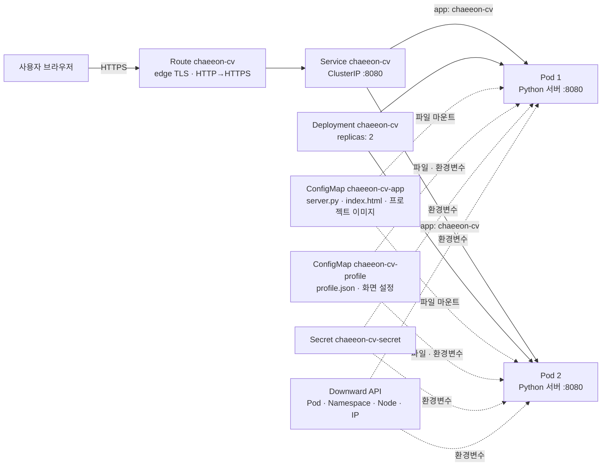

# chaeeon-cv — OpenShift 터미널 포트폴리오

지능형IoT플랫폼 · 나만의 컨테이너 만들기 · `students/202355561`

## 1. 컨테이너 소개

**chaeeon-cv**는 명령어로 이력과 프로젝트를 탐색하는 포트폴리오 웹 서비스입니다. 일반 포트폴리오 화면은 KOR/ENG 언어 전환과 프로젝트별 이미지도 제공합니다. 자기소개 페이지에 OpenShift의 Pod 정보, ConfigMap, Secret, 상태 검사, 복제본 구성을 연결해 수업에서 배운 Object의 역할을 직접 확인할 수 있도록 구성했습니다.

| 기능 | 사용 방법 | 구현 요소 |
|---|---|---|
| 터미널 포트폴리오 | `about`, `research`, `experience`, `projects`, `skills`, `awards`, `contact` | `profile.json` ConfigMap |
| 일반 포트폴리오 | `gui` 또는 `/#portfolio`, 상단 KOR/ENG 버튼 | 브라우저 UI, 프로젝트별 이미지 |
| 실행 Pod 정보 | `neofetch`, `oc get pod`, `hostname` | Downward API, `/api/info` |
| 요청 분산 확인 | `lb 10` | Deployment 복제본 2개, Service, Route |
| 숨김 메시지 | `sudo cat .secret` | Secret, `/api/sudo` |
| 상태 검사 | `/healthz`, `/readyz` | Liveness / Readiness Probe |

## 2. 아키텍처



브라우저 요청은 Route에서 TLS를 종료한 뒤 Service를 통해 Ready 상태의 Pod로 전달됩니다. Python 서버는 ConfigMap으로 마운트한 `index.html`과 `/assets/`의 프로젝트 이미지를 반환하고 `/api/profile`, `/api/info`, `/api/sudo`를 제공합니다. Route는 쿠키 기반 고정 세션을 비활성화하고 `roundrobin`을 설정했습니다.

### 사용한 Object와 역할

| 파일 | Object | 역할 |
|---|---|---|
| `k8s/deployment.yaml` | Deployment `chaeeon-cv` | Pod 2개, 이미지, 실행 명령, 리소스, 볼륨, 환경변수, Probe를 정의합니다. RollingUpdate는 `maxUnavailable: 0`, `maxSurge: 1`입니다. |
| `k8s/service.yaml` | Service `chaeeon-cv` | `app: chaeeon-cv` Pod를 선택하고 8080/TCP를 컨테이너의 `http` 포트에 연결합니다. |
| `k8s/route.yaml` | Route `chaeeon-cv` | 외부 접속 주소를 제공하고 edge TLS 및 HTTP→HTTPS 리다이렉트를 설정합니다. |
| `k8s/configmap-app.yaml` | ConfigMap `chaeeon-cv-app` | `server.py`, `index.html`, 프로젝트 이미지 5장을 `/opt/app-root/app`에 읽기 전용 마운트합니다. |
| `k8s/configmap-profile.yaml` | ConfigMap `chaeeon-cv-profile` | `profile.json`을 파일로 마운트하고 환영 문구와 기본 테마를 환경변수로 제공합니다. |
| `k8s/secret.yaml` | Secret `chaeeon-cv-secret` | 데모용 `sudo` 인증값과 메시지를 환경변수로 제공합니다. |
| `k8s/deployment.yaml` | Downward API | Pod 이름·namespace·노드·IP와 리소스 제한을 서버에 전달합니다. |
| `k8s/deployment.yaml` | Readiness / Liveness Probe | `/readyz`는 필요한 파일의 마운트를 확인하고 `/healthz`는 서버 응답을 확인합니다. |

## 3. 사용 이미지

| 항목 | 설정 |
|---|---|
| 이미지 주소·태그 | `registry.access.redhat.com/ubi9/python-311:latest` |
| 실행 명령 | `python3 -u /opt/app-root/app/server.py` |
| 컨테이너 포트 | `8080/TCP` |
| Service 포트 | `8080/TCP` |
| 리소스 | 요청: CPU 20m·메모리 48Mi / 제한: CPU 200m·메모리 128Mi |

Red Hat UBI Python 이미지는 OpenShift의 비루트 실행 환경에 적합합니다. 서버를 Python 표준 라이브러리로 작성하고 코드를 ConfigMap으로 주입했으므로 별도 이미지 빌드나 패키지 설치 없이 배포할 수 있습니다. 컨테이너는 비루트로 실행하며 권한 상승을 금지하고 Linux capability를 제거합니다.

## 4. 배포 방법

OpenShift Developer Sandbox에 `oc` CLI로 로그인한 다음 저장소 루트에서 아래 명령을 실행합니다. 적용 대상 프로젝트는 `oc project`로 확인합니다.

```sh
cd students/202355561
oc project
oc apply -f k8s/
oc rollout status deployment/chaeeon-cv
oc get deployment,replicaset,pod,service,route -l app=chaeeon-cv
oc get configmap,secret -l app=chaeeon-cv
oc get endpoints chaeeon-cv
oc get route chaeeon-cv -o jsonpath='https://{.spec.host}{"\n"}'
```

Pod 2개가 `1/1 Running`, Deployment가 `2/2`가 되어야 합니다. 브라우저에서 출력된 Route 주소를 열면 터미널 포트폴리오가 나타나고, `/#portfolio`에서는 KOR/ENG 전환이 가능한 포트폴리오 화면과 프로젝트별 이미지를 볼 수 있습니다. `/healthz`는 서버가 응답하면 HTTP 200, `/readyz`는 `index.html`과 `profile.json`이 마운트됐을 때 HTTP 200을 반환합니다.

```sh
HOST=$(oc get route chaeeon-cv -o jsonpath='{.spec.host}')
for endpoint in / /healthz /readyz; do
  echo "Testing $endpoint"
  curl -sS -o /dev/null -w 'HTTP %{http_code}\n' "https://$HOST$endpoint"
done
```

채점자가 `k8s/`만으로 재배포할 수 있도록 YAML에는 고정 `namespace`, Route `host`, `uid`, `status` 등 클러스터가 생성하는 필드를 넣지 않았습니다. 재배포를 확인할 때는 **본인 Sandbox 프로젝트에서만** 다음 절차를 사용합니다.

```sh
oc delete -f k8s/
oc apply -f k8s/
oc rollout status deployment/chaeeon-cv
```

`src/`의 원본 코드·프로젝트 이미지를 수정한 경우 `python3 tools/gen_configmaps.py`로 ConfigMap YAML을 다시 생성하고 `oc apply -f k8s/`로 적용합니다. 코드나 환경변수 변경은 `oc rollout restart deployment/chaeeon-cv`로 새 Pod에 반영합니다.

## 5. 배포 결과

OpenShift Developer Sandbox에서 Deployment와 ReplicaSet **2/2 Ready**, Pod **2개 1/1 Running**, Service **8080/TCP**, Route **edge/Redirect** 상태를 확인했습니다.


Developer 콘솔 Topology 화면에서 `chaeeon-portfolio` 애플리케이션의 Python Deployment `chaeeon-cv`를 확인했습니다.


Route 주소로 접속한 터미널 포트폴리오에서 `neofetch`를 실행해 Pod 이름, namespace, 노드, Pod IP, 이미지, 리소스 제한이 표시되는 것을 확인했습니다.


Route의 `/`, `/healthz`, `/readyz`는 각각 **HTTP 200**을 반환했습니다.

## 6. 어려웠던 점과 해결 과정

| 현상 | 원인과 해결 |
|---|---|
| `oc get all` 끝에 `applications.app.k8s.io is forbidden` 오류가 표시됨 | 현재 계정에 해당 API 리소스의 목록 조회 권한이 없습니다. Pod·Deployment·Service·Route는 조회되므로 배포 자체의 오류는 아닙니다. `oc get deployment,replicaset,pod,service,route -l app=chaeeon-cv`로 과제에 필요한 리소스만 확인했습니다. |

## 7. AI·참고자료 활용 내역

| 도구·자료 | 활용 내용 |
|---|---|
| Claude (Anthropic) | 주제 아이디어, 터미널 UI·Python 서버, OpenShift YAML과 README의 초안 작성에 활용했습니다. |
| Codex | 과제 기준에 맞춰 README 구성과 배포 증빙 설명을 정리하는 데 활용했습니다. |
| [Kubernetes ConfigMap](https://kubernetes.io/docs/concepts/configuration/configmap/) | 설정과 파일의 Pod 주입 방식 참고 |
| [Kubernetes Downward API](https://kubernetes.io/docs/concepts/workloads/pods/downward-api/) | Pod 메타데이터와 리소스 정보 주입 방식 참고 |
| [Kubernetes Probes](https://kubernetes.io/docs/concepts/configuration/liveness-readiness-startup-probes/) | Readiness·Liveness Probe 설정 참고 |
| [OpenShift Route configuration](https://docs.openshift.com/container-platform/latest/networking/routes/route-configuration.html) | Route와 TLS 설정 참고 |

## 폴더 구조

```text
students/202355561/
├── README.md
├── k8s/
│   ├── configmap-app.yaml
│   ├── configmap-profile.yaml
│   ├── deployment.yaml
│   ├── route.yaml
│   ├── secret.yaml
│   └── service.yaml
├── src/
│   ├── index.html
│   ├── profile.json
│   ├── server.py
│   └── assets/             # 킬링파트 제공 이미지와 4개 프로젝트 일러스트
├── tools/gen_configmaps.py
└── images/
    ├── 01-resource-status.png
    ├── 02-topology.png
    └── 03-browser-terminal.png
```
