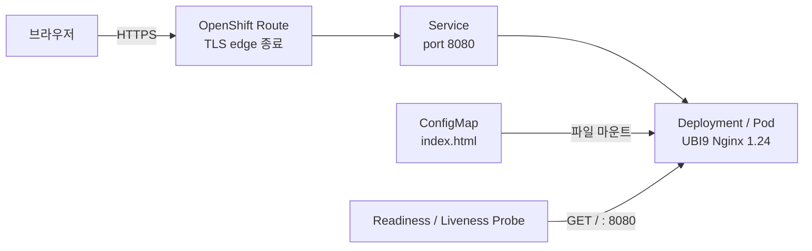

# 여채언의 AI · Robotics · Cloud 엔지니어 포트폴리오

**학번:** 202355561  
**서비스:** `chaeeon-portfolio`  
**한 줄 소개:** 로봇·AI 연구와 웹·모바일 개발 경험을 소개하는 반응형 정적 웹사이트

## 1. 컨테이너 소개

로봇 조작, 컴퓨터 비전, 웹·모바일 프로젝트를 한곳에서 보여주는 개인 포트폴리오입니다. 과제의 목적에 맞춰 공개된 Red Hat UBI Nginx 이미지를 사용하고, 페이지 전체를 ConfigMap으로 주입했습니다. 따라서 컨테이너 이미지를 직접 빌드하거나 외부 저장소에서 페이지를 내려받지 않아도 됩니다.

주요 화면은 소개, 대표 프로젝트 6개, 기술 분야, GitHub 연결로 구성했습니다. 반응형 레이아웃과 키보드 탐색을 지원하며 외부 폰트·스크립트·이미지에 의존하지 않습니다.

## 2. 아키텍처



| Object | 역할 |
| --- | --- |
| ConfigMap | 전체 HTML·CSS를 `index.html`로 보관합니다. |
| Deployment | Nginx Pod 1개를 실행하고 ConfigMap 파일을 웹 루트에 마운트합니다. CPU·메모리 요청 및 상한을 지정합니다. |
| Service | `app: chaeeon-portfolio` Pod를 8080 포트로 연결합니다. |
| Route | OpenShift가 부여한 호스트명으로 HTTPS 접속을 제공합니다. 호스트명은 YAML에 고정하지 않았습니다. |
| Readiness/Liveness Probe | `/`의 HTTP 응답으로 트래픽 수신 가능 여부와 프로세스 상태를 확인합니다. |

**사용 이미지:** `registry.access.redhat.com/ubi9/nginx-124:latest`  
**애플리케이션 포트:** `8080/TCP`  
**선택 이유:** Red Hat의 UBI9 Nginx 1.24 이미지는 비특권 실행을 지원하며 `/opt/app-root/src`의 정적 파일을 8080 포트로 제공합니다. Docker Hub 익명 다운로드 제한을 피할 수 있습니다. `latest` 태그는 재배포 시 갱신될 수 있으므로, 최종 Sandbox 실증 뒤 사용된 digest로 고정하면 재현성이 더 높아집니다.

## 3. 저장소 구조

```text
students/202355561/
├── README.md
├── k8s/
│   ├── configmap.yaml      # 전체 웹페이지를 포함한 배포 필수 파일
│   ├── deployment.yaml
│   ├── service.yaml
│   └── route.yaml
├── site/
│   └── index.html          # 편집하기 쉬운 원본; 배포 시 필요 없음
└── images/
    └── README.md           # Sandbox 실증 후 캡처 저장 위치
```

`site/index.html` 수정 후에는 같은 내용을 `k8s/configmap.yaml`의 `data.index.html`에 반영해야 합니다. 현재 두 파일은 일치합니다.

## 4. 배포 및 확인

OpenShift Developer Sandbox에서 **본인 프로젝트**를 선택하고, 웹 콘솔의 **Copy login command**로 `oc`에 로그인합니다. 저장소 루트에서 다음을 실행합니다.

```bash
cd students/202355561
oc apply -f k8s/
oc rollout status deployment/chaeeon-portfolio --timeout=120s
oc get pods,svc,route
oc get endpoints chaeeon-portfolio
oc get route chaeeon-portfolio -o jsonpath='{.spec.host}{"\n"}'
```

마지막 명령으로 나온 호스트에 `https://`를 붙여 브라우저로 접속합니다. **“생각을 실험으로, 실험을 서비스로.”**라는 제목과 프로젝트 카드가 보이면 정상입니다. 터미널에서는 다음처럼 HTTP 응답을 확인할 수 있습니다.

```bash
ROUTE_HOST=$(oc get route chaeeon-portfolio -o jsonpath='{.spec.host}')
curl -fLsS "https://${ROUTE_HOST}/" | head
```

### `k8s/`만으로 재현성 확인

기존 리소스를 삭제하고 동일한 폴더만 다시 적용합니다. **실제 제출 전 본인 Sandbox에서 반드시 실행해야 합니다.**

```bash
oc delete -f k8s/ --ignore-not-found
oc apply -f k8s/
oc rollout status deployment/chaeeon-portfolio --timeout=120s
oc get pods,svc,route
```

ConfigMap을 수정한 뒤 이미 배포된 Pod에 반영할 때는 `oc rollout restart deployment/chaeeon-portfolio`를 실행합니다. `subPath`로 마운트한 파일은 실행 중인 Pod에 자동 갱신되지 않기 때문입니다.

## 5. 배포 결과 및 증빙

**현재 상태 (2026-10-27): 로컬 파일 제작 완료, Developer Sandbox 실제 배포는 미검증.** 이 작업 환경에는 `oc` 로그인 세션이 없어 Pod Running, Route 응답, 삭제 후 재배포 성공을 확인하지 못했습니다. 성공 화면이나 명령 출력을 임의로 만들지 않았습니다.

배포 후 아래 자료를 `images/`에 추가하고 이 절의 미검증 문구를 실제 결과로 교체합니다.

1. `oc get all` 또는 Topology 화면 캡처
2. Route로 접속한 포트폴리오 화면 캡처
3. 삭제 후 재배포한 `oc rollout status` 결과와 Route 주소

## 6. 예상 문제와 확인 방법

- `ImagePullBackOff`: 이미지 주소와 Sandbox의 외부 레지스트리 접근을 확인합니다.
- `CrashLoopBackOff` 또는 권한 오류: `oc logs deployment/chaeeon-portfolio`를 확인합니다. 이 이미지는 비특권 실행을 지원하고 포트 8080을 사용하도록 선택했습니다.
- Route에서 `Application is not available`: `oc get pods`, `oc get endpoints chaeeon-portfolio`, `oc describe route chaeeon-portfolio` 순서로 확인합니다. Service selector와 Pod label은 모두 `app: chaeeon-portfolio`입니다.
- Pod가 `Pending`: 프로젝트 할당량을 확인합니다. 이 Pod의 요청량은 CPU `25m`, 메모리 `64Mi`입니다.

## 7. AI·참고자료 활용 내역

- **Codex:** 포트폴리오 HTML/CSS, ConfigMap 및 Deployment·Service·Route 초안 작성, 과제 지침과 YAML 구조 검토에 사용했습니다. 실제 Sandbox 검증을 대체하지 않습니다.
- **과제 지침:** 「나만의 컨테이너 만들기」 PDF의 폴더 구조, 채점 기준, 재현성 확인 절차를 따랐습니다.
- **Red Hat / Software Collections:** [UBI9 Nginx 1.24 이미지 정보](https://catalog.redhat.com/software/containers/ubi9/nginx-124/657b066b6c1bc124a1d7ff39), [컨테이너 사용법](https://github.com/sclorg/nginx-container/blob/master/1.24/README.md)을 참고했습니다.
- **프로젝트 정보:** 이전에 정리한 본인 프로젝트 이력 및 각 카드에 연결한 공개 GitHub 저장소를 바탕으로 작성했습니다. 공개 링크가 확인되지 않은 위성영상 분석 프로젝트에는 링크를 넣지 않았습니다.

## 제출 전 확인

- [x] 학번 폴더와 `k8s/` 구성
- [x] Deployment·Service·Route·ConfigMap 및 Probe 작성
- [x] YAML에 `namespace`, 고정 Route `host`, 클러스터 자동 생성 필드 없음
- [ ] 본인 Sandbox에서 `oc apply -f k8s/` 성공 확인
- [ ] Route HTTPS 접속과 Pod Running 확인
- [ ] `oc delete -f k8s/` 후 재배포 확인
- [ ] 실제 캡처를 `images/`에 추가하고 이 README의 배포 결과 갱신
- [ ] GitHub 저장소에 commit·push 후 저장소 URL 제출

